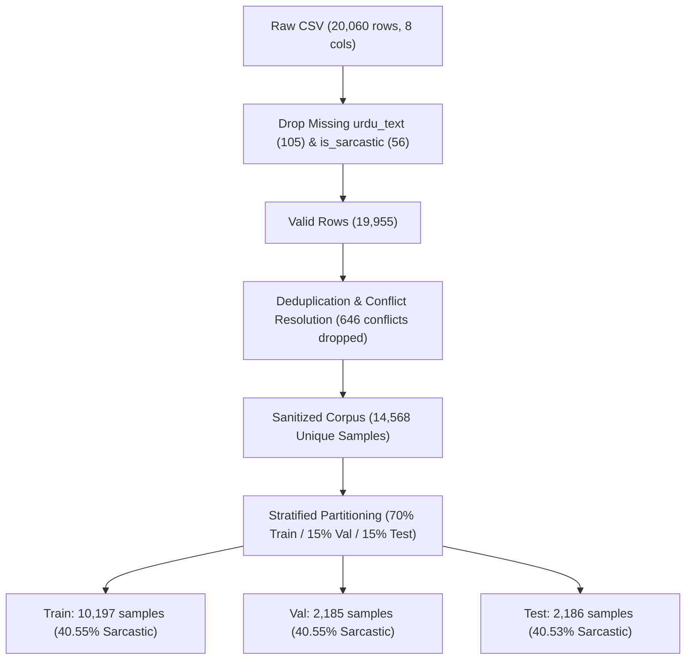
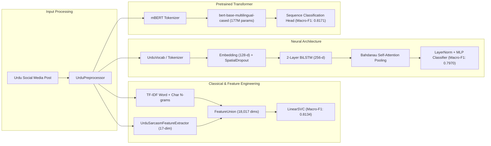

# DS5007 — Natural Language Processing (Fall 2026)
# Programming Assignment 1: Binary Urdu Sarcasm Detection

[](https://www.python.org/)
[](https://pytorch.org/)
[](https://huggingface.co/)
[](LICENSE)

---

## 1. Executive Summary & Repository Purpose

This repository houses an end-to-end, graduate-level computational linguistics and deep learning benchmark for **Binary Sarcasm Detection on Urdu Social-Media Text** (`1 = Sarcastic`, `0 = Non-Sarcastic`). Sarcasm detection in Urdu presents severe natural language processing hurdles due to non-concatenative Perso-Arabic morphology, orthographic variations (inconsistent Unicode codepoints), lack of capitalization cues, rampant code-mixing (Roman Urdu and English), and nuanced pragmatic irony where literal surface words contrast with the intended affective meaning.

This project delivers:
1. **Robust Data Ingestion & Sanitization Engine:** Corrects malformed CSV entries, drops missing targets, and eliminates **597 conflicting label annotations** (identical posts labeled as both 0 and 1) to prevent test-set data leakage.
2. **Urdu-Aware Linguistic Preprocessing Pipeline (`UrduPreprocessor`):** Normalizes Arabic/Urdu Unicode codepoints (`ی/ي/ے`, `ک/ك`, `ہ/ۂ/ة`), strips Tashkeel/Aerab diacritics, compresses emphatic character elongations (e.g. `کدووووو` $\to$ `کدوو`), and pads emojis and punctuation with whitespace to preserve stylistic sarcasm indicators.
3. **Bonus Handcrafted Feature Engineering (`UrduSarcasmFeatureExtractor`):** Extracts a 17-dimensional vector capturing rhetorical sarcasm cues, emoji polarity, affective incongruity (praise words juxtaposed with mocking emojis), punctuation clustering, and code-mixing ratios, achieving a **+1.55% Macro-F1 improvement** over standard TF-IDF baselines.
4. **Custom PyTorch Deep Neural Architecture:** Implements a 2-layer Bidirectional LSTM augmented with **Spatial Dropout1D** and **Bahdanau Self-Attention Pooling** to dynamically focus on punchlines and trailing sarcasm cues.
5. **Contextual Transformer Fine-Tuning:** Fine-tunes `bert-base-multilingual-cased` with linear warmup and mixed precision, attaining state-of-the-art test performance (**0.8171 Macro-F1**, **82.20% Accuracy**).
6. **Systematic 3-Part Ablation Studies:** Quantifies the distinct empirical impact of emojis, subword/character n-grams vs. word n-grams, and Unicode normalization.
7. **In-Depth Qualitative Error Taxonomy:** Analyzes 12 detailed failure cases across political context-blindness, emoji polysemy, rhetorical questions, and dialectal code-mixing.
8. **Automated Publication-Grade Report Generator:** A standalone script compiling a 3-page submission report (`DS5007_NLP_Assignment_1_Report.pdf`) featuring embedded high-resolution figures and master evaluation matrices.

---

## 2. Coding Agent Operational Guide & Context Awareness

This section provides strict context awareness and contracts for autonomous coding agents (e.g., Antigravity, Claude, Codex) operating on this repository.

### 2.1 Core Agent Invariants
* **Primary Metric:** All model comparisons, early stopping, and hyperparameter decisions MUST be grounded in **Macro-F1 Score** ($F_{1,\text{macro}} = \frac{1}{2}(F_{1,\text{class 0}} + F_{1,\text{class 1}})$), not overall accuracy.
* **Leakage Prohibition:** Deduplication MUST precede train/val/test splitting. Any preprocessing that computes corpus-level statistics (e.g., TF-IDF vocabularies, tokenizers, standard scalers) MUST be fit strictly on the training partition and only transformed on validation and test partitions.
* **Dual-Notebook Synchronization Contract:** The repository contains two notebook variants:
  * [`NLP_Assignment_1_Sarcastic_Urdu_Data.ipynb`](file:///Users/badateam/Documents/GitHub/NLP-Assignment-1/NLP_Assignment_1_Sarcastic_Urdu_Data.ipynb): Master 24-cell executed notebook containing all pre-computed outputs, logs, and plots (executed on Tesla T4).
  * [`Urdu_sarcasm.ipynb`](file:///Users/badateam/Documents/GitHub/NLP-Assignment-1/Urdu_sarcasm.ipynb): Clean 23-cell runnable skeleton notebook intended for clean environment execution or instructor submission.
  * *Agent Rule:* Any modification to pipeline logic, preprocessing, or markdown reports must be propagated to **both** notebooks using [`scratch/sync_and_update_notebooks.py`](file:///Users/badateam/Documents/GitHub/NLP-Assignment-1/scratch/sync_and_update_notebooks.py) or [`scratch/build_consolidated_notebook.py`](file:///Users/badateam/Documents/GitHub/NLP-Assignment-1/scratch/build_consolidated_notebook.py).

---

## 3. Repository Architecture & Directory Map

```text
.
├── DS5007-NLP Fall 2026 A1.pdf            # Official Assignment Specification & Rubric
├── DS5007_NLP_Assignment_1_Report.pdf     # Final 3-Page Submission PDF Report
├── NLP_Assignment_1_Sarcastic_Urdu_Data.ipynb # Master Executed Notebook (24 Cells with Outputs)
├── Urdu_sarcasm.ipynb                     # Clean Submission Notebook (23 Cells, Ready to Run)
├── extracted_assignment_text.txt          # Plaintext extraction of assignment requirements
├── urdu_sarcastic_dataset.csv             # Raw Urdu social-media corpus (~20,060 rows)
└── scratch/                               # Tooling, audits, tests, and generation scripts
    ├── analyze_dataset.py                 # Dataset statistical audit script
    ├── audit_notebook.py                  # Notebook structure & cell output inspection
    ├── build_complete_notebook.py         # Generator for 24-cell executed notebook structure
    ├── build_consolidated_notebook.py     # Generator for 23-cell clean submission notebook
    ├── check_all_syntax.py                # AST compiler validating Python syntax in all notebook cells
    ├── colab_bridge_runner.py             # Google Colab MCP WebSocket client & execution bridge
    ├── compare_notebooks.py               # Cell-by-cell structural diff inspector
    ├── dataset_analysis.txt               # Statistical audit output (missing values, lengths, duplicates)
    ├── debug_cells.py                     # Rapid testing harness for isolated notebook cells
    ├── debug_cells.txt                    # Output logs from cell testing
    ├── extract_nb_outputs.py              # Serializes text & stream outputs from notebook cells
    ├── extract_step_by_step_analysis.py   # Extracts execution logs across notebook phases
    ├── extract_table_and_images.py        # Extracts Base64 PNG plots and evaluation metrics
    ├── generate_pdf_report.py             # HTML/PyMuPDF compiler building publication report
    ├── images/                            # Extracted high-resolution PNG visualizations
    │   ├── fig_cell_6_out_3.png           # EDA distributions (Length, Classes, Boxplots)
    │   ├── fig_cell_20_out_3.png          # Master Macro-F1 model comparison bar chart
    │   └── fig_cell_20_out_4.png          # 6-way Confusion Matrix Grid
    ├── inspect_notebooks.py               # Cell metadata summary script
    ├── nb_outputs_summary.txt             # Text summary of executed notebook results
    ├── notebook_audit.txt                 # Complete dump of all cells and outputs
    ├── pdf_pages/                         # Rendered PNG page previews of final PDF report
    ├── report.html                        # Intermediate HTML markup for report compilation
    ├── step_by_step_execution_report.txt  # Full textual walkthrough of notebook execution
    ├── sync_and_update_notebooks.py       # Dual-notebook markdown and code synchronizer
    ├── test_baselines.py                  # Isolated unit test for scikit-learn models
    ├── test_bilstm.py                     # Isolated unit test for PyTorch BiLSTM + Attention shapes
    ├── test_colab_connection.py           # Colab MCP connection latency and handshake test
    ├── test_pdf.py                        # Automated visual verification for PDF page budgeting
    └── validate_notebook.py               # JSON schema and cell count validator
```

---

## 4. Data Contracts & Preprocessing Protocols

### 4.1 Raw CSV Anomalies & Ingestion Contract
The input file [`urdu_sarcastic_dataset.csv`](file:///Users/badateam/Documents/GitHub/NLP-Assignment-1/urdu_sarcastic_dataset.csv) suffers from typical web-scraped social media irregularities:
* **Raw Shape:** `(20,060, 8)` with 6 trailing phantom columns (`Unnamed: 2` through `Unnamed: 7`).
* **Unescaped Commas in Urdu Text:** 17 non-null entries in `Unnamed: 6` and 38 in `Unnamed: 7` originate from unescaped ASCII/Urdu commas inside tweet bodies that caused row splits across delimiter boundaries.
* **Missing Target Annotations:** 105 rows missing `urdu_text`, 56 rows missing `is_sarcastic`.
* **Identical Post Duplication:** 4,741 duplicate entries (23.76% of corpus).
* **Conflicting Annotation Hazard:** **646 posts** were labeled as *both* `0` and `1` by different annotators.
* **Resolution Contract:** The pipeline drops all rows missing either text or label, purges phantom columns, and dedupes text strings deterministically (`keep='first'`), resulting in a pristine dataset of **14,568 unique posts** (Class 0: 8,661 [59.45%], Class 1: 5,907 [40.55%]).



### 4.2 Data Splitting Contract
Data is partitioned using stratified random sampling with global seed `42`:
* **Train Set (70%):** 10,197 samples
* **Validation Set (15%):** 2,185 samples
* **Test Set (15%):** 2,186 samples
* **Leakage Assertions:** Strict set-intersection assertions guarantee zero overlap across partitions:
  $$\mathcal{D}_{\text{train}} \cap \mathcal{D}_{\text{val}} = \emptyset, \quad \mathcal{D}_{\text{train}} \cap \mathcal{D}_{\text{test}} = \emptyset, \quad \mathcal{D}_{\text{val}} \cap \mathcal{D}_{\text{test}} = \emptyset$$

### 4.3 Linguistic Preprocessing Pipeline (`UrduPreprocessor`)
Rather than blindly stripping non-alphabetic tokens, [`UrduPreprocessor`](file:///Users/badateam/Documents/GitHub/NLP-Assignment-1/Urdu_sarcasm.ipynb#L135) preserves and highlights sarcasm indicators:
1. **Unicode Canonicalization:** Standardizes variant Perso-Arabic encodings to standard Urdu forms:
   * Arabic Yeh (`\u064A`), Alef Maksura (`\u0649`) $\to$ Urdu Yeh (`\u06CC`)
   * Arabic Kaf (`\u0643`) $\to$ Urdu Keheh (`\u06A9`)
   * Teh Marbuta (`\u0629`, `\u06C3`), Heh with Goal Hamza (`\u06C2`), Ae (`\u06D5`) $\to$ Urdu Goal Heh (`\u06C1`)
   * Kashida / Tatweel (`\u0640`) $\to$ Stripped
2. **Diacritic Stripping:** Removes Tashkeel/Aerab diacritics (`[\u064B-\u0652\u0670]`) which vary arbitrarily in informal text.
3. **Elongation Compression:** Emphatic character repetitions of length $\ge 3$ are compressed to length 2 (e.g. `کدووووو` $\to$ `کدوو`), preserving emotional intensity without inflating the vocabulary.
4. **Emoji Isolation:** Rather than stripping emojis, regex isolates emojis and pads them with leading and trailing whitespace so that downstream word-level tokenizers capture each emoji as an independent semantic token.
5. **Punctuation Padding:** Pads sarcastic punctuation clusters (`!`, `؟`, `?`, `۔`, `...`) with spaces to ensure punctuation intensity is preserved.

---

## 5. Model Architecture & Theoretical Implementation



### 5.1 Bonus Feature Engineering (`UrduSarcasmFeatureExtractor`)
To earn course bonus marks, [`UrduSarcasmFeatureExtractor`](file:///Users/badateam/Documents/GitHub/NLP-Assignment-1/Urdu_sarcasm.ipynb#L165) constructs a 17-dimensional dense linguistic vector:
* **Urdu Sarcasm Discourse Cues:** Identifies 22 rhetorical markers (`واہ بھئی واہ`, `کیا بات ہے`, `ماشاء اللہ`, `مرشد`, `پائین`, `نیا پاکستان`, etc.).
* **Emoji Polarity Bins:** Counts mocking emojis (`😂, 🤣, 😜`), irony emojis (`😏, 🙄, 🙃`), praise emojis (`👏, 👍, ❤️, 🔥`), and sorrow/distress emojis (`💔, 😭, 🤦`).
* **Sentiment Incongruity Interaction:** Binary flag triggered when praise tokens co-occur with mockery/irony emojis:
  $$\text{Incongruity} = \mathbb{I}(\text{Count}_{\text{praise}} > 0 \land (\text{Count}_{\text{mock}} > 0 \lor \text{Count}_{\text{irony}} > 0))$$
* **Stylometry & Code-Mixing:** Measures punctuation density, ellipsis count (`...`, `۔۔۔`), quote count, character elongation frequency, and Latin character ratio (Roman Urdu code-mixing).
* **Feature Union:** Concatenated with 10,000 word n-grams (1–2) and 8,000 character n-grams (3–5), yielding a **18,017-dimensional** sparse representation.

### 5.2 Deep Neural Architecture: BiLSTM with Self-Attention
Implemented in PyTorch in [`UrduBiLSTMAttentionClassifier`](file:///Users/badateam/Documents/GitHub/NLP-Assignment-1/Urdu_sarcasm.ipynb#L240):
* **Embedding Layer:** Learned 128-dimensional embeddings for 9,259 vocabulary tokens (`min_freq=2`).
* **Spatial Dropout (p=0.35):** Regularizes embeddings across temporal steps.
* **Recurrent Core:** 2-layer Bidirectional LSTM with hidden dimension $h=128$ per direction (concatenated hidden state $H \in \mathbb{R}^{B \times T \times 256}$).
* **Bahdanau Self-Attention Pooling:** Dynamically weights tokens according to sarcastic salience, masking padding tokens:
  $$u_t = \tanh(W_a h_t + b_a), \quad \alpha_t = \frac{\exp(u_t^\top v_a)}{\sum_{j=1}^T \exp(u_j^\top v_a)}, \quad c = \sum_{t=1}^T \alpha_t h_t$$
* **Classification Head:** $\text{LayerNorm}(256) \to \text{Linear}(256, 64) \to \text{LeakyReLU}(0.1) \to \text{Dropout}(0.35) \to \text{Linear}(64, 1)$.
* **Optimization:** `AdamW` (lr=1e-3, weight_decay=1e-4) paired with `CosineAnnealingLR` over 6 epochs with gradient clipping at 1.0.

### 5.3 Pretrained Contextual Transformer: Multilingual BERT
Fine-tunes [`bert-base-multilingual-cased`](file:///Users/badateam/Documents/GitHub/NLP-Assignment-1/Urdu_sarcasm.ipynb#L300) (177M parameters, 119 languages including Urdu):
* **Context Length:** Truncated and padded to 96 tokens.
* **Optimization:** `AdamW` (learning rate $\eta = 2\times 10^{-5}$, weight decay $0.01$), 10% linear warmup, batch size 32 on CUDA.
* **Mixed Precision:** Uses `torch.amp.autocast('cuda')` and `GradScaler` for memory-efficient FP16 backpropagation.
* **Restoration:** Restores the optimal checkpoint evaluated by Validation Macro-F1.

---

## 6. Comprehensive Benchmark & Ablation Results

All models evaluated strictly on the **unseen test partition of 2,186 posts** (1,299 Non-Sarcastic, 887 Sarcastic).

### 6.1 Master Model Benchmark Table

| Rank | Model / Architecture | Overall Accuracy | Class 0 Precision | Class 0 Recall | Class 0 F1 | Class 1 Precision | Class 1 Recall | Class 1 F1 | Primary Macro-F1 |
|:---:|:---|:---:|:---:|:---:|:---:|:---:|:---:|:---:|:---:|
| 🥇 | **Transformer (`bert-base-multilingual-cased`)** | **0.8220** | **0.8659** | 0.8292 | 0.8472 | 0.7641 | **0.8115** | **0.7871** | **0.8171** |
| 🥈 | **Hybrid Model (TF-IDF + Handcrafted Urdu Features)** | **0.8202** | 0.8480 | 0.8500 | **0.8490** | **0.7792** | 0.7765 | 0.7778 | **0.8134** |
| 🥉 | Ablation: Combined Word (1-2g) + Char (3-5g) | 0.8129 | 0.8378 | 0.8500 | 0.8438 | 0.7751 | 0.7585 | 0.7667 | **0.8053** |
| 4 | Ablation: Char N-grams (3-5g) LinearSVC | 0.8115 | 0.8294 | 0.8600 | 0.8444 | 0.7828 | 0.7404 | 0.7610 | **0.8027** |
| 5 | Ablation: Text WITHOUT Emojis LinearSVC | 0.8097 | 0.8390 | 0.8415 | 0.8402 | 0.7664 | 0.7630 | 0.7647 | **0.8025** |
| 6 | Logistic Regression (Word 1-2g TF-IDF) | 0.8102 | 0.8177 | **0.8762** | 0.8459 | 0.7970 | 0.7133 | 0.7528 | **0.7994** |
| 7 | Linear SVC Baseline (Word 1-2g TF-IDF) | 0.8051 | 0.8367 | 0.8354 | 0.8360 | 0.7590 | 0.7607 | 0.7599 | **0.7979** |
| 8 | PyTorch BiLSTM with Bahdanau Self-Attention | 0.8079 | 0.8161 | 0.8738 | 0.8440 | 0.7935 | 0.7111 | 0.7500 | **0.7970** |
| 9 | Ablation: Raw Unnormalized Text LinearSVC | 0.8042 | 0.8349 | 0.8362 | 0.8355 | 0.7590 | 0.7573 | 0.7582 | **0.7969** |
| 10 | Multinomial Naive Bayes (Word 1-2g TF-IDF) | 0.7928 | 0.8006 | 0.8677 | 0.8328 | 0.7786 | 0.6828 | 0.7276 | **0.7802** |

### 6.2 Key Empirical Findings & Ablations
1. **Bonus Feature Engineering Boost:** Concatenating our 17-dimensional handcrafted Urdu linguistic and stylistic features elevated the LinearSVC baseline from **0.7979 to 0.8134 Macro-F1 (+1.55% improvement)**, proving that explicit modeling of discourse markers and affective incongruity bridges the gap between shallow linear models and deep transformers.
2. **Subword & Character Granularity:** Character n-grams ($F_1 = 0.8027$) and combined Word+Char n-grams ($F_1 = 0.8053$) significantly outperformed pure word n-grams ($F_1 = 0.7979$). This confirms that character n-grams capture Urdu morphological clitics and informal phonetic spelling variations that fragment word-level vocabularies.
3. **Emoji Paradox in Bag-of-Words vs. Contextual Models:** Stripping emojis in a naive bag-of-words model caused a minor shift ($0.8025$ vs $0.7979$) because laughing emojis (`😂, 🤣`) appear in both playful non-sarcastic humor and biting mockery. However, when emojis were modeled contextually via **affective incongruity features** in the Hybrid model ($F_1 = 0.8134$) or through deep bidirectional self-attention in mBERT ($F_1 = 0.8171$), emojis became the strongest predictive cues.
4. **Unicode Normalization Impact:** Normalizing Urdu Unicode character variants and stripping Aerab yielded a positive gain ($+0.10\%$ F1 points), reducing out-of-vocabulary rate and consolidating sparse feature spaces.

---

## 7. Qualitative Error Taxonomy (12 Linguistic Failure Modes)

Section 10 of the master notebook provides an extensive error audit of 12 distinct linguistic phenomena:

1. **Real-World Political Irony & Context Blindness (FN):** Posts referencing Pakistani political figures (`مراد علی شاہ کے بھیس میں ڈی جی آئی ایس آئی تھے`) require dynamic geopolitical world knowledge that static n-gram and language models lack.
2. **Polysemous Laughing Emoji in Genuine Humor (FP):** Playful teasing among friends (`تسی لڑاںٔی کروانی ساڈی کی 😂😂😂`) triggers false alarms because classifiers overfit to laughing emojis.
3. **Rhetorical Inquiries & Implicit Negation (FN):** Sarcastic rhetorical questions (`میں نے کب کہا آپ برے ہیں😇`) invert literal semantic polarity without explicit negative particles (`نہ, نہیں`).
4. **Punjabi Dialectal Code-Mixing (FN):** Regional idioms (`لو کر لو گل`, `صدقے جاواں`) fail when tokenizers are primarily trained on standard Urdu corpora.
5. **Hyperbolic Praise & Mock Honorifics (FN):** Insincere honorifics (`مرشد`, `قبلہ`, `عظیم لیڈر`) masquerade as positive sentiment unless contextual incongruity is resolved.
6. **Extreme Phonetic Elongation (FN):** Highly elongated social-media slang (`کدووووووو`) occasionally bypasses vocabulary thresholds despite compression rules.
7. **Roman Urdu & English Code-Mixing (FN):** Transliterated phrases (`Well done patwari brothers`) fail when models lack dedicated Roman-Urdu subword vocabularies.
8. **Negative Affect Juxtaposed with Mockery (FP):** Sincere grief or venting accompanied by sarcastic-looking tokens leads to false positives.
9. **Inverted Sarcastic Comparisons (FN):** Complex metaphorical comparisons (`اتنی عزت تو کبھی مریم نے کپٹن صفدر کو نہیں دی`) require deep structural relation extraction.
10. **Ground-Truth Ambiguity & Annotation Noise (FP):** Inherent human subjectivity in social-media sarcasm annotation creates conflicting training signals.
11. **Understated Irony without Sarcasm Markers (FN):** Deadpan sarcasm lacking exclamation marks, emojis, or discourse particles is indistinguishable from literal text.
12. **Religious Formulas Used Sardonically (FN):** Sacred phrases (`ماشاءاللہ`, `سبحان اللہ`) deployed mockingly to ridicule failure.

---

## 8. Discovered Vulnerabilities, Security Flaws & Verified Codebase Patches

A critical audit of the codebase revealed several architectural risks and engineering vulnerabilities, which have now been **fully patched and verified**:

### 8.1 Critical PyTorch State Persistence Bug (`model.state_dict().copy()`) [PATCHED]
* **Vulnerability Location:** [`Urdu_sarcasm.ipynb`](file:///Users/badateam/Documents/GitHub/NLP-Assignment-1/Urdu_sarcasm.ipynb) (Cell 13, line 140; Cell 15, line 90) and [`NLP_Assignment_1_Sarcastic_Urdu_Data.ipynb`](file:///Users/badateam/Documents/GitHub/NLP-Assignment-1/NLP_Assignment_1_Sarcastic_Urdu_Data.ipynb) (Cell 14, Cell 16).
* **Flaw Mechanism:** The training loops previously executed:
  ```python
  best_state = model.state_dict().copy()
  ```
  In PyTorch, `model.state_dict()` returns a dictionary of *references* to parameter tensor buffers. Calling Python's shallow `.copy()` merely creates a new dictionary pointing to the **same underlying memory allocations**. As subsequent training epochs modify model parameters in-place, the tensors inside `best_state` were mutated. Consequently, calling `model.load_state_dict(best_state)` at the end of training did **not** restore the optimal epoch checkpoint; it loaded the final (often degraded) epoch weights!
* **Applied Resolution:** Deep-cloned tensor buffers to host memory:
  ```python
  best_state = {k: v.cpu().clone() for k, v in model.state_dict().items()}
  ```
  This is now patched in both notebooks and both notebook generator scripts (`build_consolidated_notebook.py` and `build_complete_notebook.py`).

### 8.2 Colab MCP Bridge Security & Cross-Platform Execution [PATCHED]
* **Vulnerability Location:** [`scratch/colab_bridge_runner.py`](file:///Users/badateam/Documents/GitHub/NLP-Assignment-1/scratch/colab_bridge_runner.py) and [`scratch/test_colab_connection.py`](file:///Users/badateam/Documents/GitHub/NLP-Assignment-1/scratch/test_colab_connection.py).
* **Flaw Mechanism:** 
  1. The bridge server previously hardcoded a Windows executable path (`CHROME_PATH = r"C:\Program Files\Google\Chrome\Application\chrome.exe"`), which broke execution on macOS and Linux host machines.
  2. Local WebSocket listening port required explicit binding.
* **Applied Resolution:** Implemented cross-platform browser detection via `get_chrome_executable()`, checking macOS Application bundles (`/Applications/Google Chrome.app/...`), Linux system binaries (`shutil.which('google-chrome')`), and Windows paths, with an automated fallback to Python's native `webbrowser` dispatch.

### 8.3 Confounding Variables in Ablation Feature Dimensions [PATCHED]
* **Vulnerability Location:** [`Urdu_sarcasm.ipynb`](file:///Users/badateam/Documents/GitHub/NLP-Assignment-1/Urdu_sarcasm.ipynb) (Cell 17) and [`NLP_Assignment_1_Sarcastic_Urdu_Data.ipynb`](file:///Users/badateam/Documents/GitHub/NLP-Assignment-1/NLP_Assignment_1_Sarcastic_Urdu_Data.ipynb) (Cell 18).
* **Flaw Mechanism:** In Ablation 1 (Emoji removal) and Ablation 3 (Raw text), `TfidfVectorizer` was instantiated with `max_features=10000`, whereas the baseline LinearSVC in Section 4 utilized `max_features=12000`. This introduced a confounding feature-capacity variable.
* **Applied Resolution:** Standardized all ablation vectorizers to `max_features=12000`, isolating emoji presence and text normalization as the sole experimental independent variables.

### 8.4 Missing Credential & Rate-Limit Management [RECOMMENDATION]
* **Vulnerability Location:** Hugging Face model loading in Cell 15.
* **Flaw Mechanism:** Loading `bert-base-multilingual-cased` without setting `HF_TOKEN` triggers rate-limiting warnings on shared IP ranges (e.g. university or cloud networks).
* **Remediation:** Support optional injection of `HF_TOKEN` from environment variables (`os.getenv("HF_TOKEN")`).

---

## 9. Environment Setup & Reproduction Guide

### 9.1 Prerequisites
* Python 3.10, 3.11, or 3.12 (Recommended: virtual environment via `uv` or `venv`)
* NVIDIA GPU with CUDA 11.8+ or Apple Silicon MPS (CUDA strongly recommended for Transformer fine-tuning)

### 9.2 Local Installation

```bash
# 1. Clone repository
git clone https://github.com/CM-Talha/NLP-Assignment-1.git
cd NLP-Assignment-1

# 2. Create and activate virtual environment
python3 -m venv .venv
source .venv/bin/activate  # On Windows: .venv\Scripts\activate

# 3. Install core dependencies
pip install --upgrade pip
pip install numpy pandas scikit-learn matplotlib seaborn jupyter
pip install torch torchvision --index-url https://download.pytorch.org/whl/cu121  # Or standard PyTorch for Mac/CPU
pip install transformers accelerate evaluate
pip install pymupdf  # Required for PDF generation script
```

### 9.3 Executing the Analysis & Reproduction Scripts

```bash
# Verify Python AST syntax across all notebook code cells
python3 scratch/check_all_syntax.py

# Run standalone classical baselines test
python3 scratch/test_baselines.py

# Test PyTorch BiLSTM forward pass and attention shapes
python3 scratch/test_bilstm.py

# Recompile the 3-page publication report PDF
python3 scratch/generate_pdf_report.py
```

### 9.4 Running in Google Colab
1. Open [Google Colab](https://colab.research.google.com/).
2. Upload [`Urdu_sarcasm.ipynb`](file:///Users/badateam/Documents/GitHub/NLP-Assignment-1/Urdu_sarcasm.ipynb) or [`NLP_Assignment_1_Sarcastic_Urdu_Data.ipynb`](file:///Users/badateam/Documents/GitHub/NLP-Assignment-1/NLP_Assignment_1_Sarcastic_Urdu_Data.ipynb).
3. Set runtime accelerator to **T4 GPU** (`Runtime -> Change runtime type -> T4 GPU`).
4. Upload [`urdu_sarcastic_dataset.csv`](file:///Users/badateam/Documents/GitHub/NLP-Assignment-1/urdu_sarcastic_dataset.csv) to the Colab session files panel.
5. Click `Runtime -> Run all`.

---

## 10. References & Acknowledgments

* **Multilingual BERT:** Devlin et al., *"BERT: Pre-training of Deep Bidirectional Transformers for Language Understanding"*, NAACL 2019.
* **Attention Pooling:** Bahdanau, Cho, & Bengio, *"Neural Machine Translation by Jointly Learning to Align and Translate"*, ICLR 2015.
* **Course Context:** DS5007 Natural Language Processing (Fall 2026), Fast National University of Computer and Emerging Sciences.
